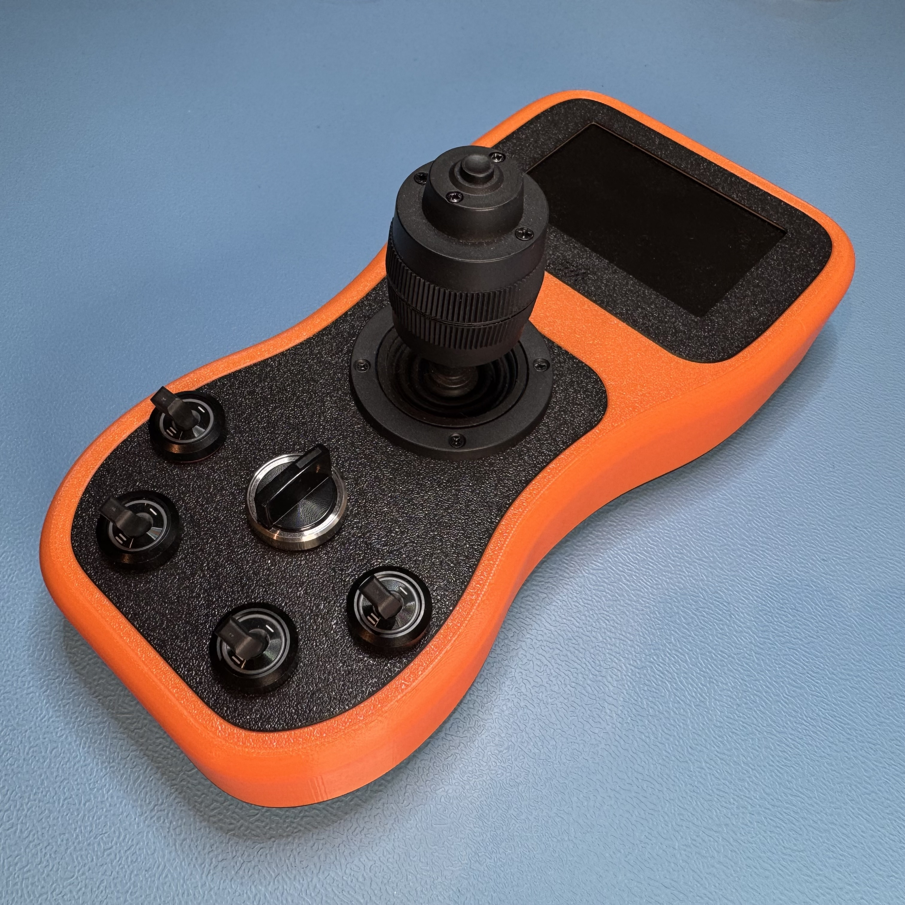
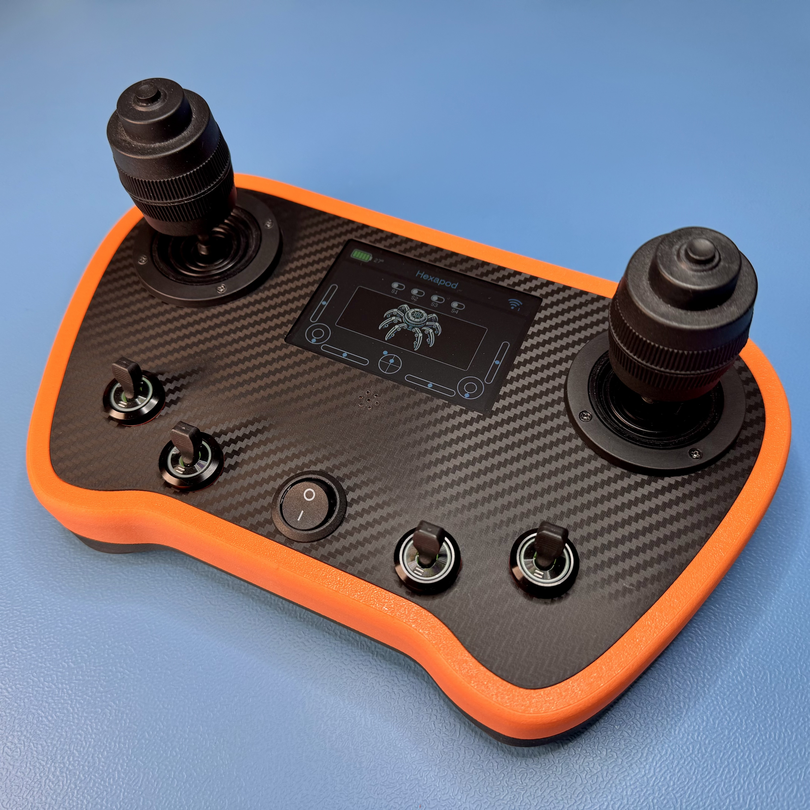

# Transmitter

A general-purpose ESP32 remote control for small robots. It is not tied to any one machine: the
link carries a fixed set of controls, and the robot at the other end decides what they mean and
what the screen shows. A hexapod is the first thing it was built to drive; adding another robot
is a change to that robot's firmware, not to this one.

It comes in two variants, with one or two joysticks. Which one is running is a menu setting
stored on the device, and is announced to the robot when the link comes up.

| One joystick | Two joysticks |
|---|---|
|  |  |

## What it does

**Sends controls 20 times a second** — two 3-axis joysticks at ±1000 per axis, their two
buttons, four switches, and the transmitter's own tilt on two axes from the IMU. 

**Takes its screen contents from the robot.** The robot sends back a name and an icon for
itself, a caption for each switch and button, and up to four label/value pairs. So a hexapod can
label a switch `Gait` and display `height=` `13.4` without this firmware knowing anything about
hexapods.

**Pairs by itself.** The robot broadcasts, the transmitter answers, and from then on each end
accepts frames only from the other. One peer at a time, dropped after a second of silence and
re-paired without user action. Both ends check a protocol version on every frame, so a robot
flashed from a different revision of the wire format reports a clear mismatch instead of
misreading values.

**Shows** battery charge, the paired robot's name and icon, live joystick positions, switch
states with their labels, IMU tilt, temperature, and an optional frame counter.

**Offers a menu** for joystick calibration (centre and end stops per axis, stored in flash), IMU
calibration, one- or two-joystick selection, sound volume, frame-rate display, and a full reset.

**Makes noise** through an I2S amplifier — a click on every switch, a beep on button presses, a
sound at start-up.

## Hardware
- ESP32­-WROOM-32E (Board package esp32 3.3.11)
- 480x320 TFT Display (ST7796 3.5)
- MPU6050 IMU  

## Repository layout

| | |
|---|---|
| [`software/`](software) | The Arduino sketch and its TFT_eSPI configuration |
| [`hardware/`](hardware) | PCB: EasyEDA project, Gerbers, schematic, bill of materials |
| [`mechanics/`](mechanics) | Housing: Fusion source, STLs, print profiles |
| [`docs/`](docs) | Photographs, wiring notes, display-image sources |

## Getting Started
1. Install the required libraries (see **Dependencies** below).
2. Open `software/Transmitter/Transmitter.ino` in the Arduino IDE.
3. Select board *ESP32 Dev Module* with 8 MB flash.
4. Upload.

The partition scheme is not a menu setting here. `software/Transmitter/partitions.csv` sits in the
sketch folder, and the ESP32 core uses it in preference to whatever *Tools → Partition Scheme*
says: a 6 MB application partition plus a 1.9 MB LittleFS partition. Nothing in the firmware writes
to that filesystem today — calibration and settings live in NVS — so there is nothing to upload to
it, but the space is reserved.

The display needs no setting up: `software/Transmitter/build_opt.h` configures TFT_eSPI as part of
the build. See [software/Config/TFT_eSPI](software/Config/TFT_eSPI/README.md) if you would rather
configure the library the conventional way, or if you are not using the ESP32 Arduino core.

## Dependencies

Versions are the ones this project is built and tested against.

**Bundled with the ESP32 board package** - nothing to install: `WiFi`, `Networking`, `Wire`,
`SPI`, `Preferences`, and the ESP-IDF `driver/i2s_std.h` audio API that SoundEngine sits on.

**From the Arduino Library Manager** - all of them, including the two written for this project:

| Library | Version | Note |
|---|---|---|
| Streaming | 6.3.0 | |
| TFT_eSPI | 2.5.43 | by Bodmer - configured by `build_opt.h`, see above |
| Bounce2 | 2.71 | |
| MPU6050_light | 1.2.1 | by rfetick - several MPU6050 libraries exist, this is the one used here |
| Adafruit MAX1704X | 1.0.3 | |
| Adafruit BusIO | 1.17.4 | dependency of MAX1704X |
| [ESPNowUtilities](https://github.com/forgevolt/ESPNowUtilities) | 1.0.0 | the ESP-NOW transport `RCProtocol.h` is built on |
| [SoundEngine](https://github.com/forgevolt/SoundEngine) | 1.0.0 | `SoundEngine.h` and the `sounds/` clips |

## License
This project is licensed under the MIT License – see the [LICENSE](LICENSE) file for details.
